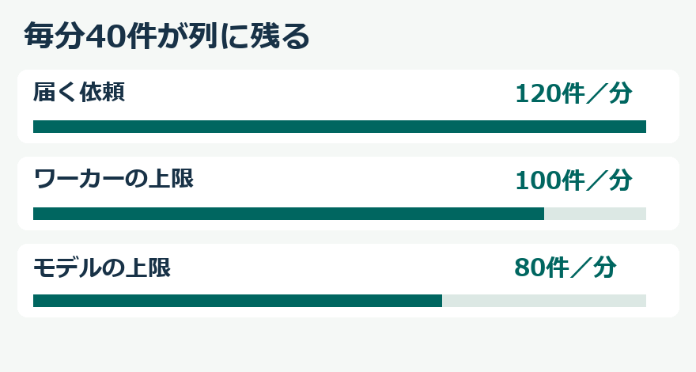
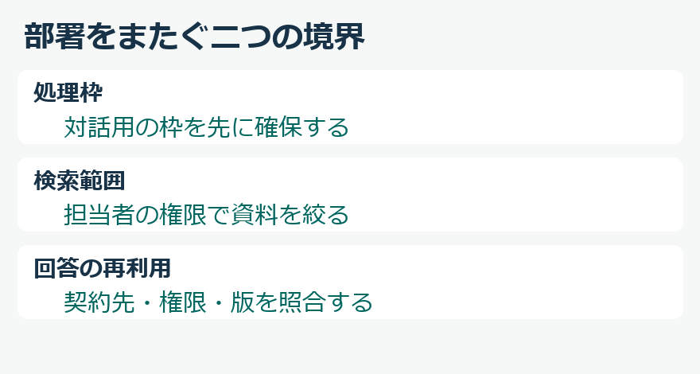
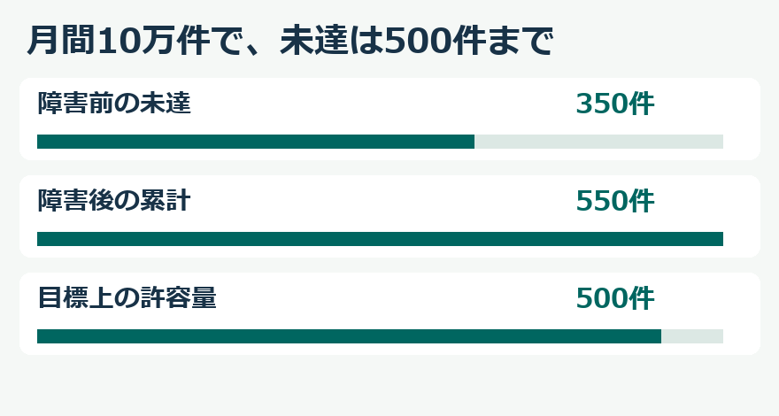
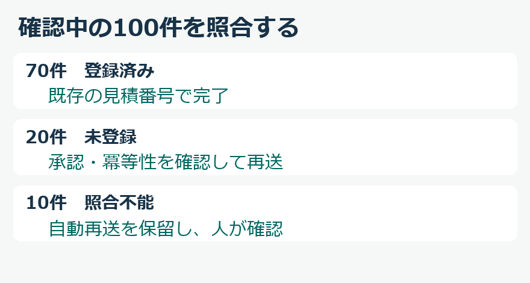
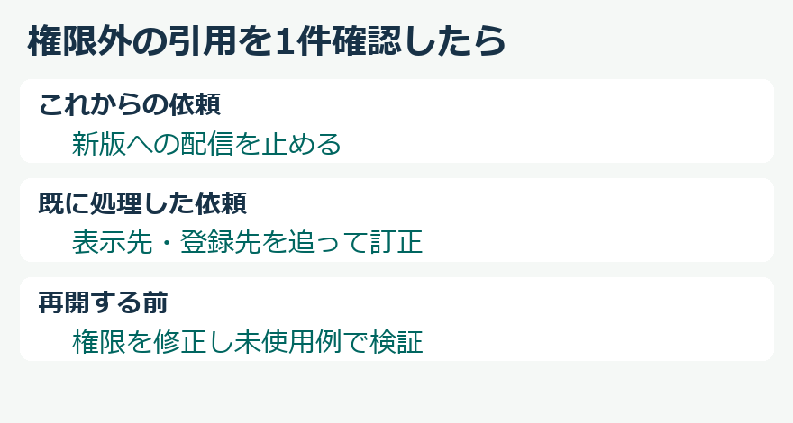
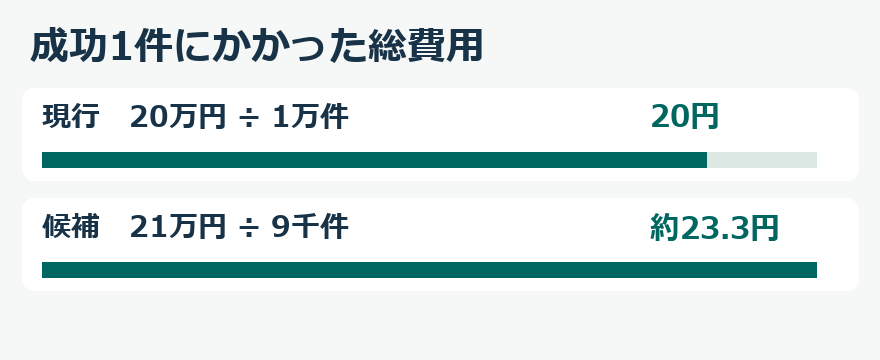

# 見積支援AIの大規模運営

月末の見積が一件遅れた。翌月、同じ仕組みを全部署が使うと、行列の裏に他部署の依頼が埋もれた。運営担当として、どこで受付を絞り、どの機能を動かし続けるかを決めよう。

## 第1章　容量設計 ── どの上限が待ち行列を作るか

**運営の見取り図**　到着 120件/分 → ワーカー上限 100件/分 → モデル上限 80件/分

月末の15分間、見積依頼が毎分120件届く。モデル呼び出しは各1回、処理時間は6秒、同時実行は10件までとする。ワーカーによる上限は10×60÷6＝毎分100件。一方、モデルの利用枠は毎分16万トークンで、1件に平均2,000トークンを使う。この枠が許すのは毎分80件だ。両方の制約を通過した仕事だけが完了する。

### 滞留を予測する

空のキューから始まり、到着・処理の速さが一定なら、毎分40件、15分で600件が残る。新規到着が止まっても消化に7分30秒かかる。実運用では長い入力や再試行も枠を使うため、入力長別の消費量と、いちばん古い依頼の待ち時間を負荷試験で確かめる。

**案件の引き継ぎ**　月末の当番です。毎分120件が到着し、ワーカーは毎分100件、モデルは毎分80件まで処理できます。この状態が15分間続く想定です。

**判断演習**　ワーカーを倍増する提案に返答してください。15分後の待ち件数を予測し、翌月の負荷試験で見る記録を一つ決めましょう。

**解答例**　モデルの上限が毎分80件なので、ワーカーだけ増やしても毎分40件、15分で600件が残ります。一括依頼をピーク外に移し、同じ負荷で最古の依頼の待ち時間が縮むか確かめます。

## 第2章　部署間の分離 ── 一部署の繁忙を他部署に広げない

**運営の見取り図**　本人の部署を確認 → 検索範囲を限定 → 部署ごとに処理枠を配分

共通キューに営業部の一括処理が1万件並ぶと、その後に来た他部署の対話依頼まで待たされる。対話と一括処理を別の列に置き、全体上限の内側で対話用の枠を確保する。部署別の待ち時間を見れば、全社平均に隠れた滞留が分かる。

### 共有してよいデータを決める

同じ製品Pでも契約先によって単価が違う。認証済みの利用者情報から部署と権限を確定し、検索候補を絞る。回答キャッシュには適用先・権限範囲・資料の版・有効日を反映する。権限が変わった場合は過去結果の再表示にも現在の権限を適用する。

**案件の引き継ぎ**　月末の混雑対策を始めたところ、営業部が一括処理で枠を使い切りました。同じ時刻に別部署の画面で、閲覧できないはずの契約価格も見つかりました。

**判断演習**　当番が先に止める処理を一つ選んでください。どの記録で影響範囲を調べ、混雑の回復は何で判定しますか。

**解答例**　影響する価格表示と保存済み回答の再利用を止めます。閲覧主体、参照した資料版、依頼番号で実際の表示先を調べます。混雑は部署別の待ち時間で追います。待ち時間が戻っても、価格の閲覧権限は別に再検証します。

## 第3章　監視と当番 ── 当番を呼ぶ条件を利用者の結果で決める

**運営の見取り図**　受付 → 根拠付き下書き完成 → 業務結果を集計

HTTPが成功しても、利用者が根拠付きの下書きを受け取れないことがある。ここでは有効な受付依頼のうち、60秒以内に正しい出典付き下書きが完成した割合をサービス指標（SLI）とする。重複送信は同じ依頼IDでまとめる。出典の有効性を機械判定し、意味上の正しさは別途、人手抽出評価で確かめる。

### 失敗の許容量を使う

月間目標（SLO）を99.5%、対象を10万件とすると、目標内の未達は500件まで。障害の20分間だけで200件失敗したら、月間許容量の40%を消費した。当番は部署別の影響と継続の有無を確認し、失敗が続くなら配信を止める。CPU使用率やモデル待ち時間は原因を絞る補助指標になる。

**案件の引き継ぎ**　月間10万件で目標99.5パーセント。未達の許容量は500件です。既に350件の未達があり、今朝さらに200件が時間内に下書きを受け取れませんでした。

**判断演習**　あなたが当番に送る第一報を声に出してください。累計の未達、影響範囲を特定する次の記録、次報の時刻を含めます。

**解答例**　例えば、累計未達は550件、想定の月間許容量を50件超えた、と伝えます。部署別の受付と完成時刻を照合し、継続中の影響を調査中、次報は15分後と明記します。次報では実際の分母と集計期間も示します。

## 第4章　障害復旧 ── 登録先が応答しない夜に何を止めるか

**運営の見取り図**　登録を一時停止 → 操作IDで照会 → 照合後に少量ずつ再開

モデル応答は正常でも、登録先の応答時間が伸びると再試行が重なり、負荷が増える。連続失敗時には登録先への新規呼び出しを一時停止し、下書きは保存する。画面には「下書き保存済み・登録確認中」を表示する。既に確定した操作を再実行すると、障害回復後に二重登録が発覚する。

### 復旧を業務台帳で確認する

当番は依頼ID、承認した版、操作ID、登録先の見積番号を突き合わせ、登録済み・未登録・照合不能に分ける。登録先が同じ操作IDを一件に確定できる場合に限り、承認が有効な未登録分を回数制限付きで再送する。照合不能分は人が確認する。復旧後は少量ずつ流し、二重登録と最古の待ち時間を監視する。

**案件の引き継ぎ**　障害の第一報を出しました。登録確認中は100件。操作番号を照合すると、70件は登録済み、20件は未登録、10件は照合不能でした。

**判断演習**　復旧担当に、三つのグループの扱いを指示してください。再送できる条件と、当番を交代してよいと判断する記録も挙げます。

**解答例**　70件は既存番号で完了。20件は承認が有効で重複防止が効く場合に少量ずつ再送。残る10件は人に割り当てます。100件それぞれに見積番号か未解決の担当者と次の確認時刻を残せば、交代後も追跡できます。

## 第5章　変更管理 ── 新モデルを全社に広げる条件を決める

**運営の見取り図**　過去案件で評価 → 少数に配信 → 拡大または切り戻し

同じ依頼でもモデル、指示文、検索索引、価格表の版が変われば結果が変わる。各依頼に使った版の組を記録する。導入前は標準案件、特約、保留すべき依頼を分けて採点する。過去入力を再生する試験では、登録や送信のツールを模擬応答に置き換えて業務上の副作用を防ぐ。

### 小さな配信で停止条件を試す

部署と案件種別が偏らない少数群で新版を使い、残りは旧版で運用する。事前に「権限外の引用が1件でもあれば即時停止」と定める。遅延や費用の判定には必要件数と観測期間も決めておく。切り戻しは以後の実行に効く。既に外部へ登録した誤見積には個別の訂正が必要だ。

**案件の引き継ぎ**　復旧後、少数部署に新版を配信しました。100件で平均2秒速くなりましたが、権限外の特約を1件引用しました。配信前に合意した即時停止条件に該当します。

**判断演習**　新版を止めた直後です。既に処理した見積をどう調べますか。次回の配信前に、どんな案件で再検証しますか。

**解答例**　依頼番号から利用者、資料版、表示先、登録先まで追い、影響した見積を訂正します。再現例を回帰テストに残し、別の未使用案件でも権限外の資料が検索候補から除外されることを確かめてから少数配信を再開します。

## 第6章　費用と運営責任 ── 節約が利用者の仕事を増やしていないか

**運営の見取り図**　推論・検索・人手の費用 → 正しく完了した件数 → 成功1件当たりの費用

モデルの単価だけを下げても、保留や手直しが増えれば総費用は上がる。月の推論・検索費と確認作業の人件費を合計し、同じ期間に正しく完了した案件数で割る。部署や入力長で分けると、一部の長文依頼が費用を押し上げているのか、確認作業が増えたのかを区別できる。

### 運営会議で判断を閉じる

サービス責任者は品質目標と予算、当番は異常の初動、営業責任者は登録内容の業務判断を担当する。週次レビューでは「誰が・どの指標を・いつ確認し・何を変えるか」を一件ずつ決める。対話用の予算を守りたいなら、予測超過時に一括処理を延期するなど、利用者への案内まで決めておく。

**案件の引き継ぎ**　運営会議です。現行は推論と検索に12万円、人の確認に8万円、成功1万件。新案はそれぞれ9万円と12万円で、成功9千件でした。

**判断演習**　予算担当に、採否と根拠を一文で伝えてください。次の改善で人の負担が増えた理由を確かめるには、どの記録を集めますか。

**解答例**　現行は成功1件20円、新案は約23.3円なので、費用削減としては見送ります。部署別に差し戻し理由と確認時間を記録します。最初の章で見た混雑も併せて確認し、安い構成が待ち時間や手直しを増やしていないか同じ条件で比較します。

## 修了課題　月末当番の運営メモ

月末に新モデルを試している最中、営業部の待ち時間が増え、登録結果も一部不明になった。運営メモに、①影響と観測値、②先に止める処理と継続する処理、③担当者と復旧順、④再開・拡大の条件を書こう。

合格の目安は、別の当番がメモを読み、操作IDで照合できない案件を保留し、キューが減っても登録照合が終わるまで障害を追え、配信を戻す条件を数値または観測事実で説明できること。

## 参考にした投稿

容量制限・非同期処理・再実行は [System Design Roadmap](https://x.com/UPing123zzz/status/2122623386610487503)、権限・観測・評価は [LLM Engineering Career Roadmap](https://x.com/UPing123zzz/status/2122275733817192629) の問題提起を参考にした。投稿本文は公開ミラーで確認した。見積の数値、運営目標、障害シナリオ、判断基準は本教材の架空設定である。
