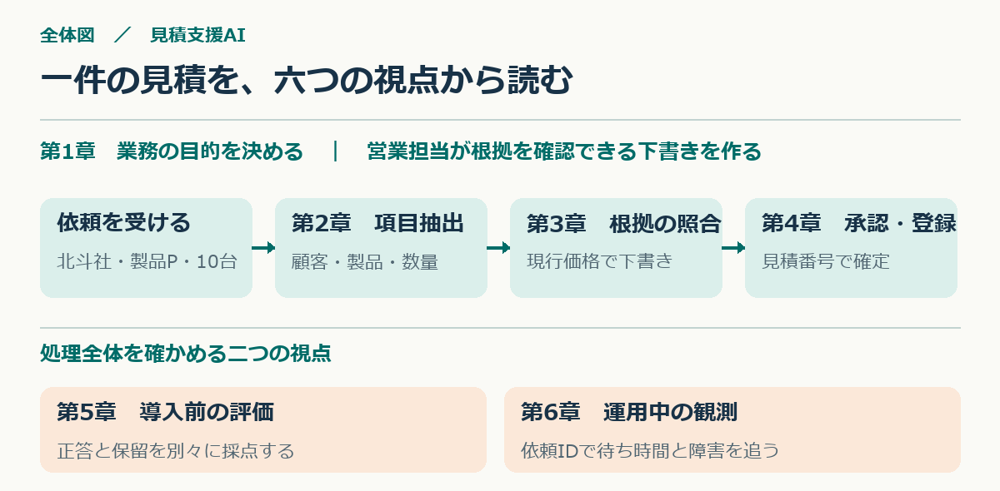
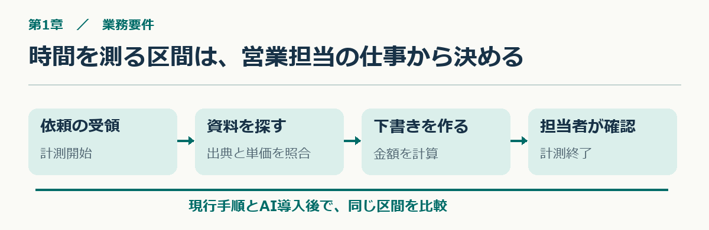
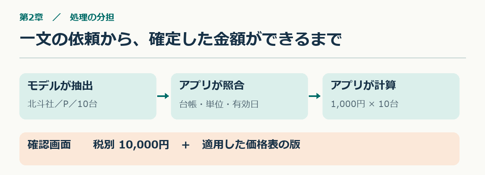
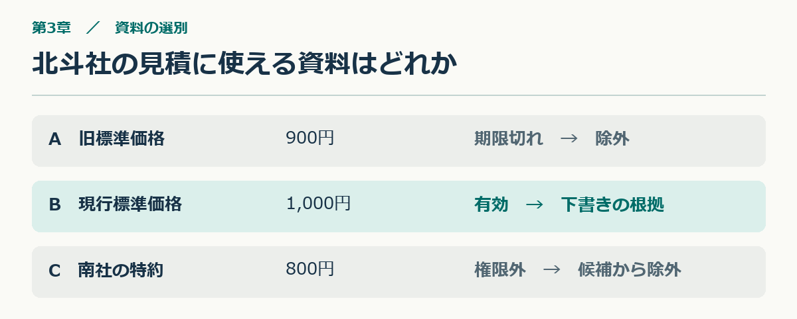
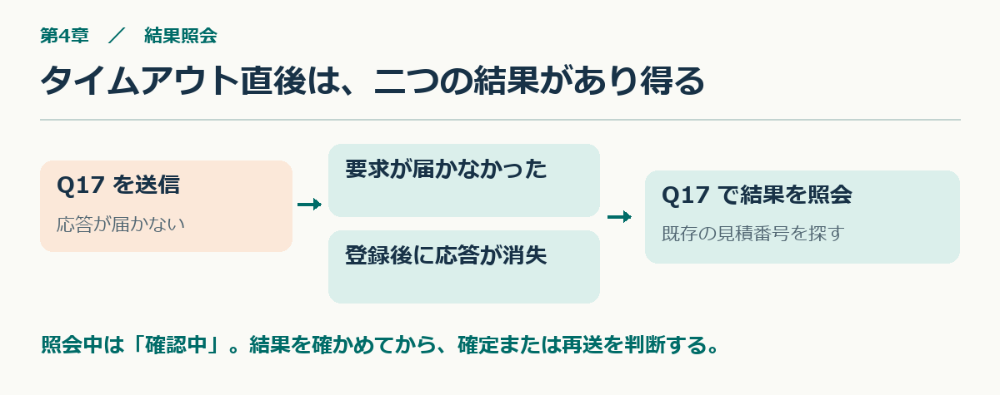
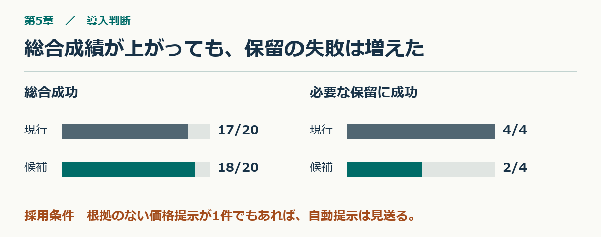
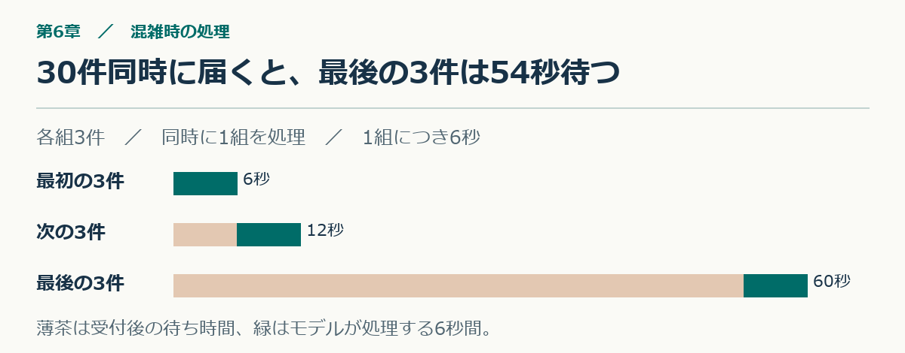

# AIエンジニアのための業務システム設計入門

## はじめに　「見積をお願い」から何を設計するか

「北斗社に製品Pを10台。今日の価格で見積をお願い」。営業担当の葵さんがこう入力すると、画面に「合計9,000円です」と表示された。文章は自然で、計算も合っている。ところが現行の単価は1,000円だった。なぜ間違えたのか。モデルを交換すれば直るのか。

本書は、生成AIを使ったことがある人が、初めて業務向けのAI機能を設計するための入門書である。この一件を、要件、モデル、データ、実行、評価、運用の順に追う。各章の問いには、本文を閉じて一文で答えてみよう。巻末に解答がある。

## 第1章　何をもって仕事が終わったとするか

見積の作業を観察すると、葵さんは価格表を探し、顧客に適用できる条件を読み、金額を計算し、社内で確認してから送付している。「見積作成を自動化する」という依頼だけでは、どこまで終えたら成功なのか決まらない。価格表を探すのに時間がかかるなら、最初の提供範囲を「根拠付きの下書きが届くまで」と決められる。文面の確認が負担なら、解決すべき箇所は変わる。

**要件**とは、利用者が達成したい結果と、その際に守る条件である。この例では、営業担当が現行価格の根拠を確認できること、送付前に本人が承認することが条件になる。「担当者以外の特約を読めないこと」も、検索段階から設計に影響する要件である。

改善を測るには**ベースライン**、つまり比較の出発点がいる。今の手順で、依頼の受領から確認済み下書きの完成までを計る。AI導入後も同じ区間を計る。生成に3秒しかかからなくても、金額と出典を調べ直すのに8分かかれば、その8分は利用者の作業時間である。案件の難しさが偏らないよう、標準価格と特約の案件を分けて比較するとよい。

**章末問題 1**　標準価格表が一枚だけで、製品と数量を選ぶ既存フォームがある。最初に何を試せば、AIを導入する意味を判断できるか。

## 第2章　モデルに任せる仕事を切り出す

大規模言語モデル（LLM）は、入力された文章などを**トークン**という単位で扱い、それまでの文脈に続く出力を生成する。自然な依頼文から項目を読み取ったり、根拠を読みやすい言葉に直したりする用途に使える。一方、現行の社内価格は業務データで決まる。モデルに会社名と製品名を教えただけでは、その時点で有効な価格表を確認したことにはならない。

そこで、入力から表示までを小さな処理に分ける。

| 処理 | この例で責任を持つ部分 | 確認するもの |
| --- | --- | --- |
| 依頼文を読む | モデルが顧客・製品・数量の候補を抽出 | 「10台」が製品Pの数量に対応するか |
| 入力を確定する | アプリが顧客台帳・製品台帳と照合 | 顧客が一意か、数量は正の整数か |
| 単価を決める | 価格照会処理が条件に合うレコードを取得 | 適用先、有効日、通貨、税区分 |
| 下書きを表示する | アプリが金額を計算し、出典と一緒に表示 | 単価1,000円 × 10台 ＝ 税別10,000円 |

たとえば「前回と同じ数で」と入力されたら、数量は文面だけでは決まらない。抽出結果に「未確定」を表せるようにしておくと、アプリは該当する過去注文を照会したり、利用者に確認したりできる。また、承認画面の金額は確定した計算結果から直接表示する。説明文を生成するときにモデルが数字を書き換えても、その値が登録処理に入り込まない構造にできる。

**章末問題 2**　抽出結果が「顧客＝北斗社、製品＝P、数量＝10」という正しい形式で返った。元の依頼は「Pを10箱、各箱12台」だった。登録前の検証に何が足りないか。

## 第3章　正しい資料がモデルに届くまで

**RAG（検索拡張生成）**は、質問に関係する外部資料を取得し、その内容を入力に加えて回答を生成する方法である。価格が表に整理されていれば、製品IDと適用日によるデータベース照会で単価を確定できる。RAGが役立つのは、たとえば「この注文に配送特約が適用される理由を説明して」という問いに、契約文書の条項を添える場面だ。

文書を扱う場合は、登録時と回答時の両方を考える。登録時には条項などの意味のある単位に分け、文書ID、版、有効期間、閲覧範囲を各部分に結び付ける。単語の一致に加え、文章を数値の列で表した**埋め込み**を使えば、表現の似た箇所を探せる。ただし「質問に似ている」ことと「今日この顧客に適用できる」ことは別々に判定する。

| 手元にある資料 | 11月20日、北斗社担当としての扱い |
| --- | --- |
| A　旧標準価格、900円、10月末まで | 失効済み。今日の見積の根拠から除外 |
| B　現行標準価格、1,000円、11月から | 適用可能。版と有効日を下書きに付記 |
| C　南社専用価格、800円、南社担当のみ閲覧可 | 閲覧範囲外。モデルに渡す候補から除外 |

冒頭の誤答を調べよう。検索記録にAしかなければ、まずBを取り込めたか、有効日の絞り込みが正しかったかを見る。モデルにBを渡し、価格照会も1,000円だったのに画面が9,000円なら、生成文や古い下書きが表示に使われた経路を追う。出典が記録されていれば、同じ誤答でも調査の開始地点を決められる。

**章末問題 3**　価格表を更新した直後、新しく作った見積にだけ、ときどき旧価格が出る。回答を一時保存して再利用するキャッシュがある。原因を確かめるため何を比較するか。

## 第4章　AIが外部の状態を変えるとき

「下書きを表示する」と「顧客管理システムに見積を登録する」では、失敗時の影響が違う。後者は処理後も記録が残る。**ツール呼び出し**では、モデルが操作名と引数の候補を返し、アプリが権限、承認対象の版、引数を検証したうえで外部機能を実行する。登録には、承認済みの下書きから確定した値を使う。

葵さんが第3版を承認した。アプリは操作ID「Q17」を保存し、登録先に送信した。5秒後にタイムアウトした。この時点では二つの経緯が考えられる。要求が届かなかった場合と、登録が済んだあとで応答だけが失われた場合である。どちらでも呼び出し元が見るエラーは同じだ。

**冪等性**とは、同じ操作を繰り返しても、意図した効果が一度分に収まる性質をいう。この例では登録先がQ17と見積番号を結び付け、一意制約とトランザクションによって同時に届いた同じ要求でも一件だけ確定させる。再送には同じQ17を使う。画面には「確認中」を表示し、登録先を照会して見積番号が得られた時点で「登録済み」に進める。登録先が照会にも重複防止にも対応しなければ、担当者が登録結果を照合する手順が必要になる。

**章末問題 4**　タイムアウトの直後、葵さんが数量を12台に修正した。Q17を使って修正後の金額を送ってよいか。第3版に対して残っている仕事も答えよう。

## 第5章　導入してよいかを数字で決める

**評価セット**は、入力と期待する結果を組にした問題集である。価格の質問なら「正しい数値」「適用可能な出典」「根拠がない場合の保留」を採点条件にする。開発中に何度も見た問題は修正の確認に使い、候補の採否は調整に使っていない問題で決める。同じ案件の言い換えが双方に入ると、新しい案件にも対応できるかを見誤る。

次は同じ20問で比較した架空の結果である。事前に「根拠のない価格を1件でも提示したら、自動提示を見送る」と決めたとする。

| 構成 | 回答すべき16問で正答 | 保留すべき4問で保留 | 推論費用 |
| --- | ---: | ---: | ---: |
| 現行 | 13 | 4 | 40円 |
| 候補 | 16 | 2 | 60円 |

候補の総合成功率は18÷20＝90%で、現行の85%を上回る。しかし保留の成功は4件中2件で、採用条件を満たさない。1問当たりの推論費用も2円から3円に増えた。次に調べるのは、失敗した2件に共通する入力や取得文書である。この20問から、本番での失敗確率まで確定することはできない。

**章末問題 5**　新しい候補が全問に「担当者に確認してください」と答えた。保留すべき場面での成功率と総合成功率を計算し、両方を見る理由を説明しよう。

## 第6章　待ち時間と障害を利用者の側から見る

**レイテンシ**は一件の要求が結果を受け取るまでの時間、**スループット**は単位時間に完了できる件数である。同時に3件、各6秒で処理するモデルに30件が一斉に届いたとする。ほかの処理時間を無視すれば6秒ごとに3件完了し、最後の3件が終わるのは60秒後だ。モデルの処理自体が毎回6秒でも、最後の利用者は54秒待ってから処理が始まる。

受付時に依頼を保存し、依頼IDを返せば、画面を閉じても後で結果を確認できる。この方式では、未処理の依頼を保つ**キュー**と、そこから仕事を取り出す処理が必要になる。到着が毎分40件、処理能力が毎分30件なら、待ち件数は毎分10件ずつ増える。受付を速くするだけでは混雑は解消しない。到着件数、待ち件数、完了件数を見て、受付制限や処理能力の変更を判断する。

障害調査に備え、一つの依頼IDで「受付」「処理開始」「検索した文書の版」「モデル処理終了」「登録の確認」を追跡できるようにする。これが**トレース**の基本である。たとえば受付から52秒、モデル処理が6秒だった場合、モデルだけを速くする前に、どの区間が残り46秒を使ったか確かめる。記録する項目は調査目的に合わせて選び、閲覧権限のある契約文書の全文を全員が読めるログに複製しない。

**章末問題 6**　待ち件数はゼロ、モデル処理は通常どおり、登録確認だけが急に遅くなった。初めにどの区間の記録を確認するか。

## 章末問題の解答例

| 問 | 判断と理由 |
| --- | --- |
| 1 | 既存フォームに現行単価と出典を自動表示し、確認完了までを測る。自由文からの入力がなお負担なら、そこにモデルを使った場合の時間と訂正の手間を比較する。 |
| 2 | 数量と単位の対応が必要。台単位で登録するなら「10箱 × 12台＝120台」と変換根拠を表示する。換算条件が不明なら確認する。 |
| 3 | 同じ権限・顧客・製品・適用日の要求で、キャッシュ利用時と再取得時の単価・文書版を比較する。再取得だけが正しければ、更新時の無効化とキャッシュキーを調べる。 |
| 4 | Q17は第3版の結果照合に使う。第3版が既に登録済みなら訂正手順を決め、第4版の再承認を受ける。新しい操作には別のIDを割り当てる。 |
| 5 | 保留成功率は4/4＝100%、総合は4/20＝20%。回答できたはずの16件をすべて人に戻しており、業務負担が減らない。 |
| 6 | 依頼IDで登録要求の送信から応答・結果照会までを追い、登録先で確定した時刻と比べる。登録処理自体の遅れか、応答・照会の遅れかを切り分ける。 |

## 修了課題　設計判断を一枚にまとめる

自分の業務から繰り返し発生する依頼を一つ選び、次の四行を埋める。各行に具体的な入力、数値、記録名のいずれかを入れること。

1. 利用者と目的　「誰が、どの入力から、どの状態まで進めば成功か」
2. 処理と根拠　「どこをモデルに任せ、何をどのデータで確定するか」
3. 失敗と復旧　「どの条件で保留し、何を照会すれば安全に再開できるか」
4. 導入判断　「現行の何と比較し、どの結果なら導入を見送るか」

**自己採点**　別の担当者がメモを読み、正常な依頼、根拠不足の依頼、実行途中で応答が途切れた依頼の三つについて、次に画面に何が出るか説明できれば合格。説明が分かれた箇所に条件を一つ書き足す。

## 参考にした投稿

教材の着想は Ethan 恩宇（@UPing123zzz）の次の2投稿による。投稿本文は公開ミラーで確認した。見積業務、数値、障害記録は学習用に作成した架空例である。

1. モデル呼び出しから業務システム全体の設計・評価へと学習を広げる視点を、第1〜3章と第5章で扱った。[LLM Engineering Career Roadmap](https://x.com/UPing123zzz/status/2122275733817192629) ／ [公開ミラー](https://xitter.cf/UPing123zzz/status/2122275733817192629)
2. 再実行、待ち時間、処理能力の制約を業務上の結果まで追う視点を、第4章と第6章で扱った。[System Design Roadmap](https://x.com/UPing123zzz/status/2122623386610487503) ／ [公開ミラー](https://xitter.gq/UPing123zzz/status/2122623386610487503)
